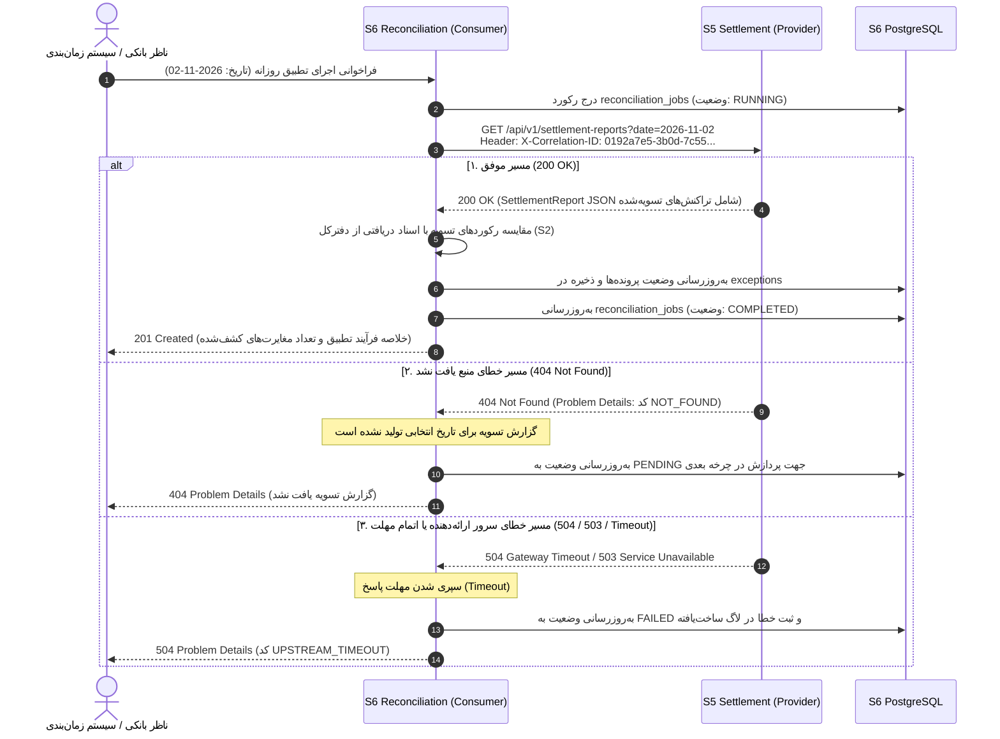

# نمودار توالی (Sequence Diagram) - تعامل سرویس ۶ به عنوان Consumer

این نمودار توالی تعامل سرویس ۶ (Reconciliation & Exceptions) را به عنوان **Consumer** در فراخوانی سرویس ۵ (Clearing & Settlement Gateway) به عنوان **Provider** برای دریافت گزارش‌های تسویه روزانه طبق نیازمندی‌های تمرین جلسه ۴ نشان می‌دهد.

## مشخصات اندپوینت فراخوانی‌شده
- **مسیر (Path):** `GET /api/v1/settlement-reports?date=2026-11-02`
- **سرآیند الزامی:** `X-Correlation-ID` (جهت ردیابی توزیع‌شده مطابق استاندارد GEN-08)
- **سناریوهای مدل‌شده در بلوک `alt`:**
  1. **مسیر موفق (200 OK):** دریافت فایل گزارش تسویه روزانه، مقایسه با اسناد دفترکل، و ثبت موفق فرآیند تطبیق.
  2. **مسیر خطای ۴۰۴ (404 Not Found):** عدم وجود فایل تسویه برای تاریخ درخواستی، دریافت قالب خطای RFC 7807، و انتقال وضعیت به `PENDING` جهت تلاش مجدد.
  3. **مسیر خطای ۵xx / اتمام مهلت زمانی (Timeout / 5xx):** قطعی سرویس ارائه‌دهنده یا عدم پاسخ در مهلت زمانی ۵ ثانیه، ثبت خطا در لاگ با کد `UPSTREAM_TIMEOUT` و تغییر وضعیت به `FAILED`.

---

